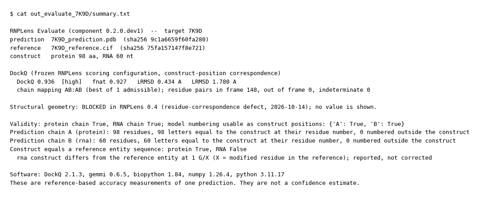
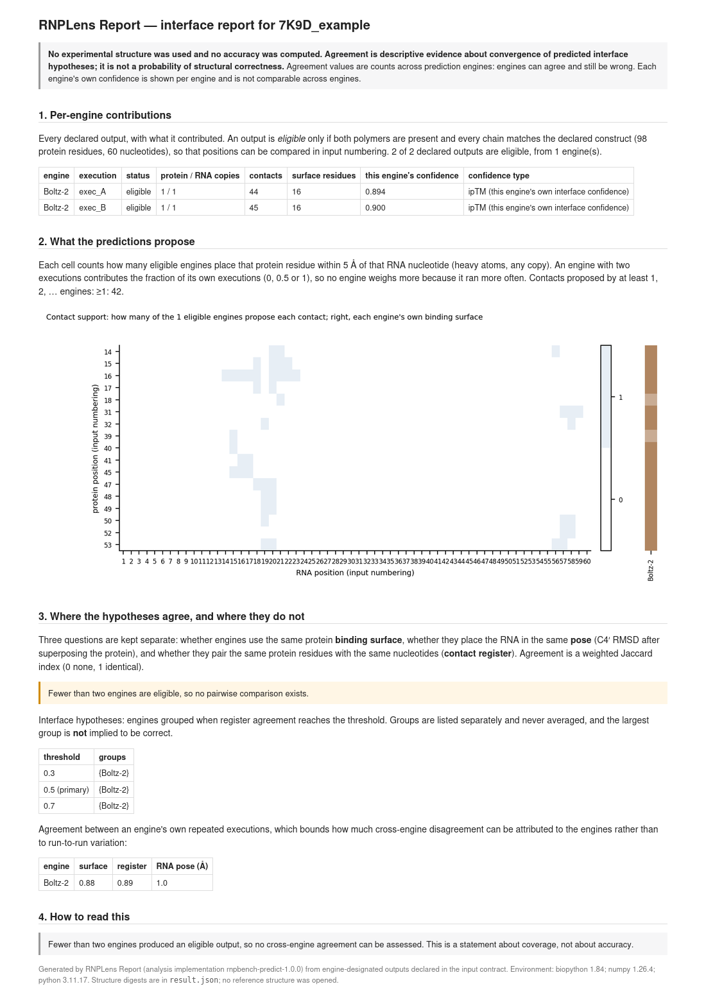
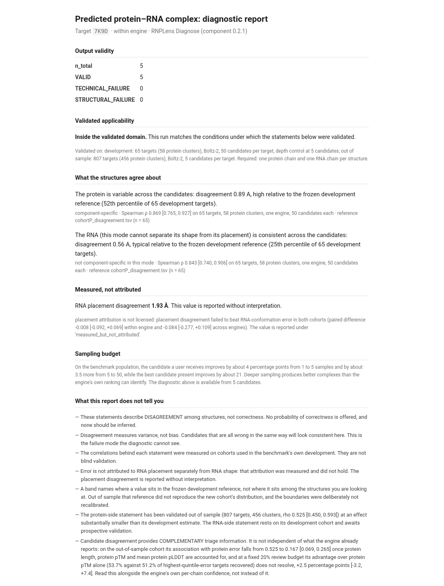

# RNPLens

**Evaluation and diagnostic tools for protein–RNA complex predictions.**

> ### Status: `v0.4.0-rc1` — source prerelease
>
> This is a **source prerelease** published so that the accompanying manuscript can cite a public code
> repository. It is **not** a final production release. Concretely:
>
> * The **core toolkit** is functionally tested: 709 tests pass in this tree, and `rnplens selftest`
>   reproduces the project's reference values (213/213 Evaluate checks, 296 Report values).
> * The **AI Assistant is an optional experimental research interface.** Its automated tests pass
>   (242 passed, 16 skipped), but native security qualification (G1–G6) is **incomplete on both
>   platforms** at this commit, and live model calls are **not qualified**. Do not treat it as a
>   production-security-qualified component.
> * Published artifacts carry the development version strings `rnplens 0.4.0.dev0` and
>   `rnplens-assistant 0.1.0.dev0`, which is what the packaging metadata declares.
>
> Please keep five different things apart when reading any claim here: **source availability**,
> **automated functional testing**, **native security qualification**, **live AI validation**, and
> **blinded comparative scientific evaluation**. Only the first two are established for this prerelease.
>
> **Capability categories.** Every capability is in exactly one of four categories
> ([docs/capabilities.md](docs/capabilities.md)):
>
> 1. **Qualified:** verified Report routes; Evaluate's DockQ-family metrics (DockQ, DockQ class, fnat, iRMSD, LRMSD); `rnplens import` and `compare`; `rnplens analyse`, qualified only for its tested, enabled analysis routes ([docs/workflow.md](docs/workflow.md)); `selftest`, `provenance` and `example-contract`, qualified as tested software infrastructure, not as independent evidence of structural accuracy.
> 2. **New descriptive functionality:** region contacts (`rnplens region`), evidence lookup (`explain`), Methods export (`export-methods`), clarification and resume (`clarify`), incremental analysis (`update`), tested grouping operations (`group`, `group-diff`), the setup check (`doctor`), the question menu `rnplens assist` (no language model; [docs/assist.md](docs/assist.md)) and the offline viewer `rnplens view`: automatically tested, awaiting manual visual confirmation.
> 3. **Experimental:** the Codex result-aware follow-up and the natural-language planner (neither is live-qualified; [docs/setup_and_privacy.md](docs/setup_and_privacy.md)); scientific claims about the usefulness of grouping (retrospectively, k = 5 representatives retained an acceptable structure in 0.86 of pool-A cases against 0.94 for confidence order; grouping is never an accuracy selector).
> 4. **Blocked:** four-axis geometry (`rnplens evaluate run` records geometry status `BLOCKED`, code `GEOMETRY_BLOCKED_IN_0.4`); the affected RNA-conformation measurements; **Diagnose** (`rnplens diagnose run|preflight|validity` and `--with-diagnose` refuse with `DIAGNOSE_BLOCKED`, exit code 5); accuracy-based candidate ranking. Also unavailable: structure prediction and mutation advice; unsupported: a snap-installed Codex, Windows.
>
> **Platforms.** Linux x86-64 is the reference platform and produced the frozen numerical values. On
> macOS arm64 the toolkit runs and reproduces every status, class, count and rounded value; a known
> trailing-digit numerical parity difference is covered by a narrowly scoped tolerance on a single
> value ([records/release/TOLERANCE_POLICY_AMENDMENT_1.md](records/release/TOLERANCE_POLICY_AMENDMENT_1.md)).
> The optional Assistant runs natively on either system and one computer is enough: Linux (bubblewrap)
> [docs/install_linux.md](docs/install_linux.md), macOS (Seatbelt) [docs/install_macos.md](docs/install_macos.md).
>
> **Records and development-host paths.** Paths beginning `records/` are development and qualification
> records kept in the repository; they are not installed and are not part of the wheel. They preserve
> development-host absolute paths (`/home/jwen/...`) and the host nickname verbatim, because recorded
> SHA-256 digests depend on those exact bytes — rewriting them would break the audit trail they exist
> to provide.
>
> **Reproducibility.** Numerical/evidence reproducibility: supported by the reported tests.
> Canonical-file byte reproducibility: passed in four development cases under the determinism contract
> ([records/replay/DETERMINISM_CONTRACT_v1.md](records/replay/DETERMINISM_CONTRACT_v1.md)). Complete
> managed-project byte reproducibility: **not established** — the original pre-registered byte-identical
> replay check failed, and that verdict stands.
>
> **Data.** Some bundled example inputs have unresolved third-party redistribution questions, recorded
> in [NOTICE](NOTICE) and summarised under *Data, licensing and limitations* below.

**New to RNPLens? Start with [Which analysis should I use?](docs/which_analysis_should_i_use.md)**

RNPLens helps researchers examine protein–RNA complex structures that have **already been predicted** (for example by
AlphaFold 3, Boltz-2, Chai-1, RoseTTAFold-family models or docking), identify where a prediction may be limited,
and produce reproducible, machine-readable assessments.

**RNPLens does not predict structures.** It does not generate complexes from sequence, does not pick a "best"
structure for you, and gives **no calibrated probability that a structure or an interface is correct**.

## What can RNPLens do?

| tool | question it answers | input | experimental structure needed? |
|---|---|---|---|
| **Evaluate** | How close is this prediction to the experimental structure? | one predicted complex, one experimental mmCIF, the construct sequences | **yes** |
| **Report** | Do several predictions of the same complex propose the same interface? | two or more predicted complexes (one or several engines) | no |
| **Diagnose** (**BLOCKED in 0.4**) | Are the outputs valid structures, and how much do the candidates disagree? | candidate structures (samples of one engine, or one per engine) | no |

Each tool answers a different question, and their outputs are never combined into a single score.

- **Evaluate** reports two independent routes side by side: a DockQ route (DockQ, fnat, iRMSD, LRMSD with construct-position residue correspondence over all admissible chain mappings) and a geometry route (RNA conformation C4′ RMSD, RNA placement after protein superposition, protein Cα RMSD). An output that cannot be scored is reported as **NO VALUE** with the stage and reason — never as zero. **In 0.4 only the DockQ route is qualified**: the geometry route is blocked by a residue-correspondence defect found on 2026-10-14 ([docs/limitations.md](docs/limitations.md)). `rnplens evaluate run` records the geometry status `BLOCKED` and shows no geometry value; `compare`, `analyse` and the menu withhold them too. The DockQ-family values are unchanged from rc3 and are not a replacement for the geometry route.
- **Report** measures agreement on the binding surface, on the exact residue–nucleotide contacts (contact register) and on RNA pose, and groups engines into interface hypotheses. **Agreement among predicted structures is descriptive evidence, not a calibrated probability of structural correctness.** Engines can agree and still be wrong.
- **Diagnose** separates technically broken files from structural failures from valid outputs, and measures protein-side and RNA-side disagreement among candidates relative to a frozen benchmark reference. Disagreement is a **review flag**, not a correctness score; **low disagreement does not guarantee an accurate structure** (candidates that are all wrong in the same way look consistent). The protein-side signal has been checked out of sample but overlaps substantially with the engine's own confidence (pTM, pLDDT); the RNA-side statement has not been validated out of sample. **In 0.4, Diagnose is BLOCKED in the public interface** until it is re-qualified under the corrected correspondence: `rnplens diagnose run|preflight|validity` and `--with-diagnose` refuse with `DIAGNOSE_BLOCKED` (exit code 5) and write nothing; the frozen rc3 component is unchanged ([docs/diagnose.md](docs/diagnose.md)).

## Quick start

Requirements: CPython 3.10, 3.11 or 3.12 on Linux (the tested interactive environment for 0.4) or macOS (the toolkit runs; the language-model modes run under a Seatbelt jail; see [installation](docs/installation.md)); no GPU. Dependencies are pinned and installed from PyPI
(DockQ 2.1.3, gemmi 0.6.5, biopython 1.84, numpy 1.26.4, scipy 1.13.1; matplotlib only for Report's HTML page).

```bash
git clone <repository-url>      # URL to be supplied at release
cd RNPLens
python3.11 -m venv .venv && source .venv/bin/activate
python -m pip install -e ".[html]"
rnplens --version
rnplens selftest                # a few seconds to about 30 s; prints PASS for all three tools
```

`rnplens --help`, `rnplens evaluate --help`, `rnplens report --help` and `rnplens diagnose --help` (which states the 0.4 block) describe every
command; `rnplens <tool> <verb> --help` lists a verb's options.

Run both worked examples below in one step (the output directory must not exist; nothing is ever overwritten):

```bash
bash examples/run_examples.sh rnplens_example_outputs
```

## Example 1 — Reference-based evaluation

A Boltz-2 prediction of PDB [7K9D](https://www.rcsb.org/structure/7K9D) (98-residue protein, 60-nt RNA) scored
against the deposited structure. Inputs are in `examples/reference_based/`: `7K9D_prediction.pdb`,
`7K9D_reference.cif`, the construct sequences `7K9D_protein.fasta` and `7K9D_rna.fasta`, and `example_input.json`,
which names them.

```bash
cd examples/reference_based
rnplens evaluate validate --input example_input.json
rnplens evaluate run --input example_input.json --out ../../out_evaluate_7K9D
```

Outputs: `result.json` (full record, including correspondence, chain mapping, SHA-256 of every input and of the
frozen scorer sources), `result.csv` (one row), `summary.txt` (the 0.4 output; excerpt):

```
DockQ (frozen RNPLens scoring configuration, construct-position correspondence)
  DockQ 0.936  [high]   fnat 0.927   iRMSD 0.434 A   LRMSD 1.780 A
  chain mapping AB:AB (best of 1 admissible); residue pairs in frame 148, out of frame 0, indeterminate 0

Structural geometry: BLOCKED in RNPLens 0.4 (residue-correspondence defect, 2026-10-14); no value is shown.
...
  rna construct differs from the reference entity at 1 G/X (X = modified residue in the reference); reported, not corrected
```

How to read it: DockQ summarises interface accuracy; fnat is the fraction of native residue–nucleotide contacts
reproduced. The geometry route (RNA shape, RNA placement on the protein, protein Cα RMSD) is blocked in 0.4: in
`result.json` its status is `BLOCKED` with the code `GEOMETRY_BLOCKED_IN_0.4` and the list of withheld fields, and in
`result.csv` its value columns are empty. The DockQ-family values do not replace it. Positions that are missing from the experimental structure are unknown,
not confirmed non-contacts. The bundled reference is a reduced copy of PDB 7K9D whose RNA sequence record lists
the 5′-triphosphate guanosine as `X`, so it is reported as a construct–reference difference and left uncorrected.
(With the full RCSB file the canonical sequence record lists it as `G`, and the construct then equals the reference
entity; the scores are identical. Evaluate compares against `_entity_poly.pdbx_seq_one_letter_code_can` when the
file has it.) These are accuracy measurements of one prediction, not a confidence estimate.

## Example 2 — Reference-free assessment

Run these from the repository root (after Example 1: `cd ../..`). No experimental structure is read. Inputs are in `examples/reference_free/`: the top-ranked output of two independent
Boltz-2 runs of 7K9D with their confidence files (`report_7K9D/`), and the five samples of one Boltz-2 run
(`diagnose_7K9D/`).

**Interface agreement (Report).** Report requires absolute paths; `example-contract` writes a filled-in contract.

```bash
rnplens example-contract examples/reference_free --out contract.json
rnplens report validate contract.json
rnplens report run contract.json --out out_report_7K9D
```

Outputs: `result.json`, `contacts_by_output.json` and a self-contained HTML page. For this example, with one engine,
Report describes **repeat agreement** between the two runs: binding-surface agreement 0.88, contact-register
agreement 0.89, RNA pose difference 0.96 Å; 47 distinct residue–nucleotide contacts were proposed, one interface
hypothesis (with a single engine there is always exactly one, so read the repeat agreement instead).
Cross-engine agreement needs outputs from several engines.

**Validity and candidate disagreement (Diagnose) — BLOCKED in RNPLens 0.4.** Diagnose is blocked in the public
interface until it is re-qualified: its statements and validated domain rest on evidence that is being recomputed
under the corrected residue correspondence. The commands refuse and write nothing:

```bash
rnplens diagnose run examples/reference_free/diagnose_7K9D/*.pdb --mode within_engine --engine BOLTZ2 --target 7K9D --out out_diagnose_7K9D
# rnplens diagnose run: DIAGNOSE_BLOCKED: Diagnose is BLOCKED in RNPLens 0.4 until it is re-qualified ...   (exit code 5)
```

The rc3 expected output of this example is kept unchanged in `examples/expected_output/B2_diagnose_7K9D/` as a
historical record; it is not a 0.4 result. The same holds for the rc3 Evaluate output kept in
`examples/expected_output/`, which still contains the geometry values. `rnplens selftest` still runs Diagnose's
internal contract checks (software checks, not evidence about your structures); Diagnose's example statements are
shown only as `Diagnose interpretation BLOCKED (checked, not shown)`.

Every `run` also writes `rnplens_run.json` next to the results: the RNPLens release, the command, and the SHA-256
of every input and output file.

The full expected outputs of both examples, with the platform they were produced on, are in
[`examples/expected_output/`](examples/expected_output/). See [docs/quickstart.md](docs/quickstart.md) for a
field-by-field walk-through.

## What the outputs look like

These are the genuine outputs of the two worked examples above. The Evaluate summary is the 0.4 output (geometry `BLOCKED`); the Report and Diagnose pages are from `examples/expected_output/`, produced with rc3, and the Diagnose page is historical, since Diagnose is blocked in 0.4.

| Evaluate (`summary.txt`) | Report (HTML page) | Diagnose (HTML page) |
|---|---|---|
| [](docs/images/example_evaluate.png) | [](docs/images/example_report.png) | [](docs/images/example_diagnose.png) |

## Interpreting results responsibly

RNPLens keeps apart quantities that are easily conflated:

- structural accuracy (Evaluate) vs physical validity of the file (Diagnose `validity`);
- RNA conformation vs RNA placement;
- binding-surface agreement vs exact contact-register agreement;
- reference-free agreement (Report, Diagnose) vs known accuracy (Evaluate);
- available structural outputs vs scoreable outputs;
- native-informed diagnostics in the manuscript vs the deployable, reference-free tools here.

See [docs/interpretation.md](docs/interpretation.md) and [docs/limitations.md](docs/limitations.md).

## Documentation

[which analysis should I use?](docs/which_analysis_should_i_use.md) · [0.4 capabilities in four categories](docs/capabilities.md) ·
[installation](docs/installation.md) · [quick start](docs/quickstart.md) · [Evaluate](docs/evaluate.md) ·
[Report](docs/report.md) · [Diagnose](docs/diagnose.md) · [output formats](docs/output_formats.md) ·
[interpretation](docs/interpretation.md) · [limitations](docs/limitations.md) ·
[reproducibility](docs/reproducibility.md) · [Evaluate input contract](docs/INPUT_CONTRACT.md) ·
[identifiers](docs/identifiers.md) · [validation records](docs/validation/) · [output schemas](docs/schemas/) ·
[example data provenance](examples/DATA_PROVENANCE.tsv) · [software vs study reproducibility](docs/paper_reproducibility.md)

Working from engine output folders (0.4): [import, analyse, compare](docs/workflow.md) · [question menu and structure viewer (`rnplens assist`, `rnplens view`)](docs/assist.md) · [viewer guide and nucleotide contact explorer](docs/viewer.md) ·
[contacts in an RNA region](docs/region.md) · [binding-proposal grouping](docs/grouping.md) ·
[evidence lookup and Methods export](docs/evidence_and_methods.md) · [managed projects: update, clarify, relink](docs/project_state.md) ·
[setup check and privacy](docs/setup_and_privacy.md) · [follow-ups](docs/followup.md) ·
[platforms and the two modes](docs/platforms.md) · [model use and privacy](docs/model_and_privacy.md) ·
[example data provenance](docs/example_data_provenance.md) · [release conditions](docs/release_conditions.md) ·
[code availability (draft)](docs/code_availability.md)

## Provenance of the implementation

RNPLens distributes the evaluation, reporting and diagnostic procedures developed and qualified for the
accompanying study. Their computations are unchanged from the internally qualified component set, and the frozen
scorer files are verified by SHA-256 at run time. A few machine-readable identifiers keep the project's earlier
internal prefix so that this stays verifiable; they are listed in [docs/identifiers.md](docs/identifiers.md). The
study's benchmark resource (its entries, partitions and score stores) is **not** part of this repository, and the
software version is independent of the manuscript's evidence build identifier. See
[docs/reproducibility.md](docs/reproducibility.md), and [docs/paper_reproducibility.md](docs/paper_reproducibility.md)
for what this repository does and does not reproduce of the study.

## The optional AI Assistant (experimental)

`rnplens-assistant` is a **separate, optional** distribution. Installing RNPLens does not install it, and
every scientific capability above works without it. It is an **experimental research interface**, not a
qualified component.

What it does: interprets a natural-language scientific question, plans a sequence of *already-qualified*
RNPLens tool calls, admits that plan deterministically (an operation the toolkit cannot perform is
**refused**, not approximated), runs it, and returns an answer linked to the evidence records the tools
produced, with a replay path that needs no language model.

```bash
pip install rnplens-assistant          # optional; after installing rnplens
python -m rnplens_assistant --help     # ask | replay | followup | replay-followup | consent
python -m rnplens_assistant replay ... # the no-language-model route
```

**Requirements.** A working Codex CLI authentication, and a native confinement backend chosen by platform:
**bubblewrap** on Linux, **Seatbelt** on macOS. The Assistant refuses to start a model process outside that
confinement, and it refuses a Codex installed in a location the installation-location rule rejects (for
example a Homebrew prefix on macOS, or a snap installation on Linux) — that refusal is intended behaviour.
See [docs/install_linux.md](docs/install_linux.md), [docs/install_macos.md](docs/install_macos.md) and
[docs/setup_and_privacy.md](docs/setup_and_privacy.md).

**Limitations you must read before using it.**

* **Native security qualification is incomplete** for this commit on both Linux and macOS. The historical
  macOS qualification of an earlier commit does **not** certify the jail wrapper shipped here, which has
  since changed.
* **Live model calls are not qualified.** Automated tests exercise the Codex route through replay and
  no-inference paths only.
* **Credential and network isolation is not proven.** The confinement restricts what the model process can
  read and reach, and the tests check that the toolkit's own output does not echo credential content — but
  this release makes **no claim of perfect isolation** of credentials or network traffic. Treat any
  sensitive material on the same machine accordingly.
* Sending a question to a hosted model sends data to a third party. Decide that is acceptable for your
  data before enabling it.
* It plans and refuses; it does not extend the science. It cannot make a blocked capability available.

## Data, licensing and limitations of this public package

**Our source code is MIT** (core and Assistant alike). Third-party components keep their own terms, recorded
in [NOTICE](NOTICE): the vendored Mol* 5.13.1 viewer bundle (MIT) and the ten components minified inside it,
and the runtime dependencies resolved by `pip` at install time (not bundled). Experimental coordinates in the
worked examples are wwPDB depositions under CC0 1.0, with their primary citations recorded.

Two honest caveats about bundled scientific data:

* **Engine-generated prediction files** (22 Boltz-2 coordinate files and 6 per-model confidence JSONs) were
  generated by this project with Boltz-2 2.2.1 on public inputs. Boltz-2's code and weights are MIT and its
  licence is **silent** about outputs. Silence is not a prohibition, and we do not claim it is one; the
  precise exact-command provenance of every file is in `examples/DATA_PROVENANCE.tsv`. The redistribution
  position is stated as an **open question**, not a restriction.
* **`src/rnpbench_diagnose/reference/cohortE_disagreement.tsv`** carries an **unresolved licensing
  conflict**: all 59 of its rows are derived in part from RoseTTAFold2NA, and the only RF2NA licence text
  this project holds reads CC BY-NC-SA 4.0 while other project documentation records MIT. See NOTICE E.5.

**What this package does and does not reproduce.** `rnplens selftest` reproduces the project's full
reference set from the bundled public data. It is **not** a reproduction of the private benchmark study: the
RNPLens-Rank corpus, its label files and its holdouts are not in this repository and are not published here.
External benchmark inputs beyond the bundled examples must be acquired or regenerated by the user; the
Boltz-2 commands that produced the bundled predictions are recorded per file.

## Citation

If you use RNPLens, please cite the accompanying manuscript (in preparation; citation details will be added on
publication) and the software release. See [`CITATION.cff`](CITATION.cff). No DOI has been issued yet.

## Licence

RNPLens is released under the [MIT licence](LICENSE), subject to institutional (ANU) intellectual-property
approval before public release. Third-party dependencies keep their own licences. Every bundled structure is listed
with its origin, terms and attribution in [examples/DATA_PROVENANCE.tsv](examples/DATA_PROVENANCE.tsv) (see also
[docs/dependencies.md](docs/dependencies.md)). Security issues: see [SECURITY.md](SECURITY.md).
