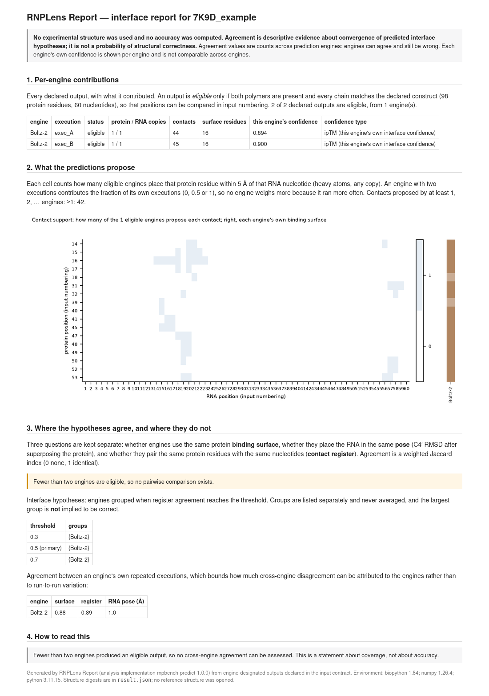
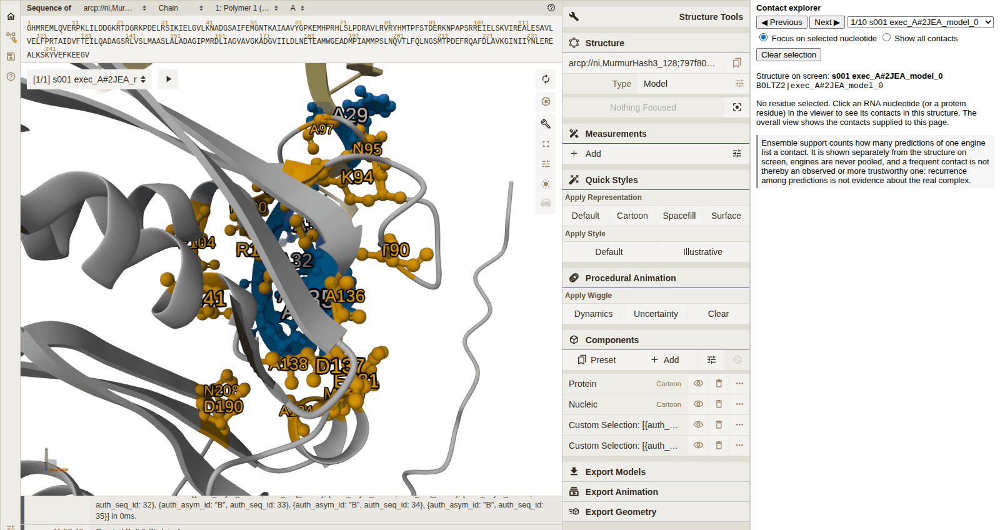

<p align="center">
  
</p>

<h1 align="center">RNPLens</h1>

<p align="center">
  <strong>Reproducible assessment of predicted protein–RNA complexes: interface accuracy against experiment, and
  agreement among predictions when no experimental structure exists.</strong>
</p>

<p align="center">
  
  
  
</p>

## Overview

Structure-prediction engines such as AlphaFold 3, Boltz-2, Chai-1 and the RoseTTAFold family now produce
protein–RNA complexes routinely. Deciding what those models actually support is harder. RNPLens evaluates and
interprets **existing** predictions in two ways:

- **With an experimental structure**, it measures interface accuracy (DockQ, fnat, iRMSD, LRMSD) under an explicit,
  construct-position residue correspondence.
- **Without one**, it measures how closely several predictions agree on the protein binding surface, the exact
  residue–nucleotide contacts and the RNA pose, and groups them into interface hypotheses.

Every result is machine-readable and records the SHA-256 of its inputs, and the bundled data reproduce the reference
values. RNPLens is intended for structural and RNA biologists comparing predicted complexes, for developers
benchmarking prediction engines, and for anyone who needs a documented record of what a set of predictions does and
does not support.

RNPLens does **not** predict structures, does not choose a "best" model, and gives **no calibrated probability**
that a structure or an interface is correct. Agreement among predictions is descriptive: engines can agree and
still be wrong.

## Features

| Capability | What it provides |
|---|---|
| **Evaluate** | Reference-based interface accuracy (DockQ, DockQ class, fnat, iRMSD, LRMSD) under an explicit construct-position residue correspondence, over all admissible chain mappings |
| **Report** | Reference-free agreement among predictions of one complex: binding surfaces, residue–nucleotide contacts and RNA poses, with engines grouped into interface hypotheses (descriptive, not a probability) |
| **Structure viewer** | `rnplens view`: an offline Mol\* page that highlights Report's contacts, with a nucleotide contact explorer |
| **Analysis workflows** | `import`, `analyse` and `compare` engine output folders; contacts in an RNA region; binding-proposal grouping (never an accuracy selector); evidence lookup and Methods export |
| **RNPLens Assistant** (optional) | An experimental natural-language interface that plans RNPLens tool calls ([below](#rnplens-assistant)) |

What each capability does and does not establish is set out in [docs/capabilities.md](docs/capabilities.md).

## Installation and quick start

Requirements: CPython 3.10, 3.11 or 3.12 on Linux x86-64 or macOS arm64; no GPU. RNPLens is not yet on PyPI and is
installed from this repository:

```bash
git clone https://github.com/JeanWen-Lab/RNPLens.git
cd RNPLens
python3.11 -m venv .venv
source .venv/bin/activate
python -m pip install -e ".[html]"
rnplens selftest          # checks the installation against the bundled reference values; prints PASS
```

**Worked example.** Score the bundled Boltz-2 prediction of PDB 7K9D against the deposited structure:

```bash
cd examples/reference_based
rnplens evaluate run --input example_input.json --out ../../out_evaluate_7K9D
cat ../../out_evaluate_7K9D/summary.txt
```

```text
DockQ (frozen RNPLens scoring configuration, construct-position correspondence)
  DockQ 0.936  [high]   fnat 0.927   iRMSD 0.434 A   LRMSD 1.780 A
  chain mapping AB:AB (best of 1 admissible); residue pairs in frame 148, out of frame 0, indeterminate 0
```

`bash examples/run_examples.sh OUT` runs this example and the reference-free one in a single step. The
[quick start](docs/quickstart.md) explains every output field and lists the expected values.

## Example outputs

| Report: agreement between two Boltz-2 runs of 7K9D | Viewer: nucleotide contact explorer (Boltz-2 prediction of PDB 2JEA) |
|---|---|
| [](docs/images/report_7K9D_v040.png) | [](docs/images/viewer_nt_overall.png) |

Both images are genuine RNPLens 0.4 outputs, cropped but otherwise unedited; their provenance is in
[docs/images/README.md](docs/images/README.md).

## Documentation

| Topic | Pages |
|---|---|
| Getting started | [Which analysis should I use?](docs/which_analysis_should_i_use.md) · [Installation](docs/installation.md) ([Linux](docs/install_linux.md), [macOS](docs/install_macos.md)) · [Quick start](docs/quickstart.md) |
| Reference-based evaluation | [Evaluate](docs/evaluate.md) · [Input contract](docs/INPUT_CONTRACT.md) · [Output formats](docs/output_formats.md) |
| Reference-free analysis | [Report](docs/report.md) · [Engine-folder workflow](docs/workflow.md) · [RNA regions](docs/region.md) · [Grouping](docs/grouping.md) · [Evidence and Methods export](docs/evidence_and_methods.md) |
| Viewer | [Viewer guide](docs/viewer.md) · [Question menu and viewer commands](docs/assist.md) |
| Assistant | [Assistant README](assistant/README.md) · [Setup and privacy](docs/setup_and_privacy.md) · [Model use and privacy](docs/model_and_privacy.md) · [Platforms](docs/platforms.md) |
| Interpreting results | [Interpretation](docs/interpretation.md) · [Limitations](docs/limitations.md) · [Capabilities](docs/capabilities.md) |
| Reproducibility and provenance | [Reproducibility](docs/reproducibility.md) · [Software versus study](docs/paper_reproducibility.md) · [Example data provenance](docs/example_data_provenance.md) · [Dependencies](docs/dependencies.md) · [Release status](docs/release_conditions.md) · [Code availability](docs/code_availability.md) |

The full index, including development and qualification records, is in [docs/README.md](docs/README.md).

## RNPLens Assistant

RNPLens Assistant is an optional AI-assisted interface (`python -m pip install -e ./assistant`). It plans supported
structural analyses, checks each execution plan deterministically, writes evidence-linked answers and replays
recorded workflows. Every capability above works without it and without any language model. The current release
includes automated software tests; live model operation and native security qualification remain under
evaluation.

Its model-dependent operation is therefore **experimental research functionality**. A question sent to a hosted
model leaves your computer.

Read the [Assistant README](assistant/README.md) and [Setup and privacy](docs/setup_and_privacy.md) before using it.

## Scope of this release

RNPLens v0.4.0 supports reference-based interface evaluation and reference-free structural comparison.
Four-axis geometry assessment and Diagnose are not available in this release; their scientific qualification is
ongoing. See [Limitations](docs/limitations.md) for details.

## Citation

If you use RNPLens, please cite this software release; its metadata are in [CITATION.cff](CITATION.cff). A citation
for the accompanying article will be added when it is published. No DOI has yet been issued for the software.

## Licence and data terms

**MIT License — Copyright © 2026 The RNPLens authors.** The licence covers the RNPLens source code: the core
toolkit and the optional Assistant ([LICENSE](LICENSE), [assistant/LICENSE](assistant/LICENSE)).

Research data and third-party components keep their own terms, which are recorded in [NOTICE](NOTICE) and
[examples/DATA_PROVENANCE.tsv](examples/DATA_PROVENANCE.tsv):

- The bundled experimental structures are wwPDB entries (CC0 1.0).
- The bundled predictions were generated by the authors with Boltz-2 (MIT); please cite Boltz-2 when reusing them.
- The vendored Mol\* viewer keeps its MIT notices.
- Runtime dependencies keep their licences ([docs/dependencies.md](docs/dependencies.md)).

The MIT licence does not extend to third-party datasets or to the outputs of other prediction engines. The study's
benchmark dataset is not part of this repository.

Contributions: [CONTRIBUTING.md](CONTRIBUTING.md). Security issues: [SECURITY.md](SECURITY.md).
