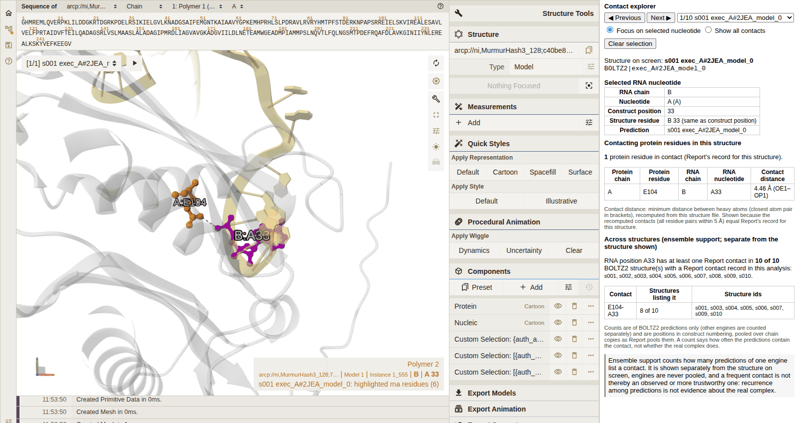
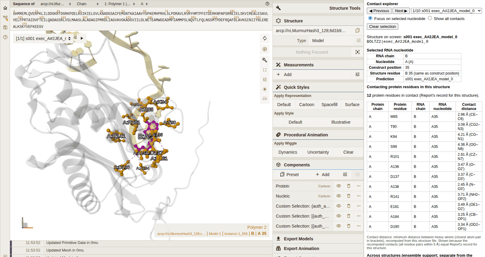
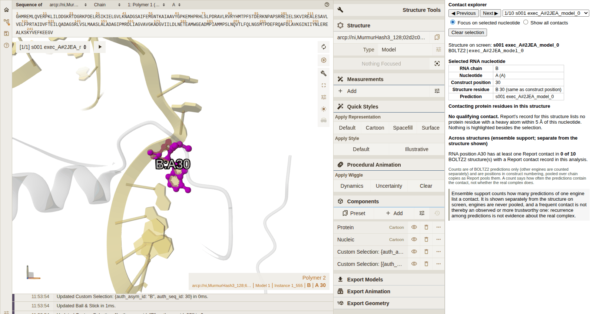
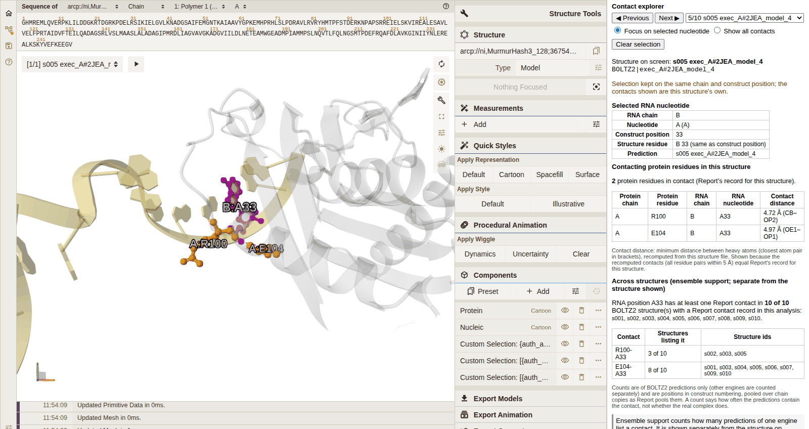

# RNPLens viewer guide: offline structure page and nucleotide contact explorer

`rnplens view PROJECT --analysis A [--rna a-b] [--ids ...] [--representatives 0.3|0.5|0.7] [--out DIR]` writes a
folder with `viewer.html`, copies of the structures and the vendored Mol* 5.13.1 files. Open `viewer.html` directly
from disk (double-click, or `file://` in Chrome); no web server and no network are used.

**Viewer status: automatically tested; basic display and interaction confirmed manually by the owner on macOS (2026-10-18); switching between binding-hypothesis representatives and offline operation not yet confirmed manually; not fully visually qualified.** The
contact explorer was checked in headless Chrome (software WebGL) against Report's records
(`records/viewer/nt_contacts/NT_CONTACTS_QUALIFICATION_REPORT.md`). Owner-reported manual test on macOS (2026-10-18; records/viewer/MOLSTAR_VISUAL_VERIFICATION.md): the 2JEA page opened, displayed the structures, rotated and zoomed, responded to nucleotide clicks, and different selections highlighted different regions. Not yet confirmed by a person: switching between binding-hypothesis representatives (6BJG) and operation with the network disconnected; the viewer is therefore not fully visually qualified.

**Everything shown is a feature of a predicted structure.** A highlighted contact means that, in this prediction, a
heavy atom of the protein residue lies within 5.0 A of a heavy atom of the nucleotide. It is not an experimentally
observed interaction, and RNPLens does not say whether the real complex has it.

## Layout

- Left: the Mol* viewer showing **one structure at a time**.
- Right: the **contact explorer** panel: Previous / Next and a structure selector, the display toggle
  (**Focus on selected nucleotide** / **Show all contacts**), **Clear selection**, and the information panel.
- Below: viewer status, colour key, limits, the list of structure copies and the table of the page's highlighted
  residues (with evidence IDs).

When nothing is selected the viewer shows the page's overall contact display: protein grey, RNA sand, the page's
highlighted protein residues orange and RNA residues blue (for `--rna a-b`, the contacts with RNA positions a-b).

## Selecting an RNA nucleotide

Click any atom or the ribbon of a nucleotide. In **Focus on selected nucleotide** mode (the default):

- the nucleotide is drawn in **magenta** and labelled with its chain, e.g. `B:A33` (chain B, adenosine at 33);
- only the protein residues that Report's record lists in contact with it **in the structure on screen** are drawn
  in **orange** and labelled (`A:E104` = chain A, glutamate 104);
- a **dashed magenta line** joins the closest heavy atoms of each contacting pair;
- the rest of the protein is faded to 30% opacity and the rest of the RNA to 60%; the camera centres on the selection
  with about 12 A of surroundings and keeps your viewing direction.

Clicking another nucleotide replaces the selection. Clicking the **same nucleotide again** clears the selection, as
does **Clear selection**; both return to the overall view. Clicking empty space changes nothing.
The faded protein is not clickable in focus mode (clicks pass through it to the RNA behind it). To select a protein
residue that is not highlighted, switch to **Show all contacts** or clear the selection first. If a nucleotide is
hidden behind others, rotate (left-drag) or zoom out (scroll) first, or use Mol*'s reset-camera button.

## Reading the contact panel

**Selected RNA nucleotide**: RNA chain; nucleotide (construct letter and, in brackets, the residue name in the file,
e.g. `PSU` for a modified nucleotide); **construct position**; **structure residue** (chain, author number and
insertion code in the file; marked when it differs from the construct position); the prediction on screen.

**Contacting protein residues in this structure**: the number of contacting residues and a table with protein chain,
protein residue (construct letter and position), RNA chain, RNA nucleotide, and **contact distance**.

### How contact distances are defined

The contact definition is Report's: any pair of heavy atoms (hydrogens excluded) within 5.0 A, first model, waters
excluded. Report's record (`report/contacts_by_output.json`) lists the contacting residue pairs but not distances.
The viewer therefore recomputes, from the same structure file and with Report's own parser, the **minimum heavy-atom
distance** of each pair, and shows it rounded to 0.01 A with the closest atom pair in brackets (e.g. `4.46 A
(OE1-OP1)`). It shows distances **only** when the recomputed set of pairs within 5.0 A equals Report's record for that
structure exactly; otherwise every distance of that structure reads **Not available** and the panel says why. In the
qualification run every structure of the 2JEA, 1VTM and 6BJG demonstration pages passed this check and an independent
recomputation with gemmi.

Very short distances (well under 2 A) mean that atoms of the two chains overlap in that prediction (a clash); the
viewer reports them as computed and does not alter or flag them.

### Nucleotides without a qualifying contact

If Report's record lists no protein residue within 5.0 A of the nucleotide in the structure on screen, the panel says
**No qualifying contact** and nothing besides the selection is highlighted. This describes this prediction only;
another candidate may differ (in the 2JEA example, B26 and B30 have no qualifying contact in any of the 10
structures).

## One structure versus the ensemble

The highlights, lines, table and count always describe **the single structure named at the top of the panel**.
Below them, a separate block **Across structures (ensemble support; separate from the structure shown)** counts how
many structures **of the same engine** with a Report contact record list the nucleotide (or each contact), e.g.
`8 of 10 BOLTZ2 structure(s)`, with the structure ids. Engines are never pooled; the denominator is always shown.
A count describes how often the predictions contain a contact. It is not a measure of how likely the contact is to
exist in the real complex.

## Switching prediction candidates or group representatives

Use **Previous / Next** or the selector. The new structure is loaded on its own; nothing drawn for the previous
structure remains. If a nucleotide is selected, the selection is kept on the **same chain and construct position**
and its contacts are re-read from the new structure's own record (the panel notes this); if that position does not
exist in the new structure, the selection is cleared with a note. With `--representatives 0.5` the selector lists
the group representatives (labelled with their group) followed by any engine-designated structure that is not a
representative.

## Show all contacts

**Show all contacts** keeps the page's overall highlights (orange/blue, unlabelled) and adds the selection (magenta)
with its partners, labels and lines, without fading. Switching the mode re-frames the page's contacts; selecting in
this mode keeps the camera where it is. Because nothing is faded in this mode, ribbons in front can hide the
selected residue; rotate, or return to focus mode.

## Clicking a protein residue

Clicking a protein residue (orange residues in focus mode; any residue in show-all mode or without a selection)
selects it: the residue is magenta, the RNA nucleotides that Report's record lists in contact with it are blue, and
the table lists them with distances.

## Numbering and chains

Nucleotides are identified by chain and construct position, never by the label text: Mol* labels a residue by its
name and number, so `A33` means adenosine 33, not chain A. The page maps a clicked residue (chain, author number,
insertion code) to its construct position using Report's correspondence (the i-th residue of the chain in the file is
construct position i; Report only analyses chains whose length equals the construct), and takes the protein and RNA
chain identities from the project manifest. A structure whose chain lengths differ from the construct has no
correspondence, and the explorer says it is not available for it.

## Offline operation

The page loads the structure copies of its folder as local scripts and Mol* from `assets/`; a Content-Security-Policy
limits connections to the page itself. In the qualification run the browser made no request other than `file:` and
`data:` requests.

## About the screenshots

The pictures in this guide are screenshots of the 2JEA RNA 26-35 demonstration page (Boltz-2 pilot, 10 structures)
taken in headless Chrome for Testing 155 with software WebGL during qualification run 2 (commit 82deb28,
`records/viewer/nt_contacts/`), cropped to the viewer and panel. Every highlighted residue, table row, count and
distance in them was compared with Report's record and an independent recomputation; the screenshots themselves are
illustrations, not the evidence.
